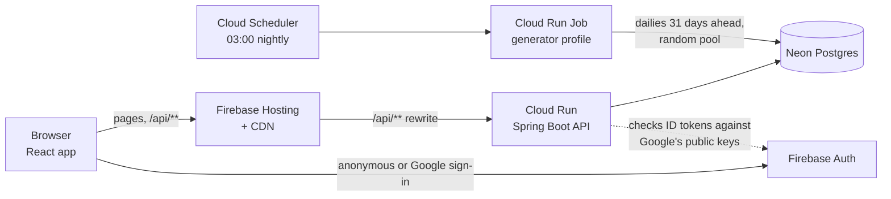

# Pidoku

[](https://github.com/noahheller/Pidoku/actions/workflows/ci.yml)

**Play it at [pidoku.web.app](https://pidoku.web.app).**

Sudoku where every row, column and box holds the first nine digits of π (3 1 4 1 5 9 2 6 5)
instead of 1–9. So **1 and 5 appear twice**, and **7 and 8 never appear**.

Three new daily puzzles every day (easy, medium and hard), with streaks, a share line, friends and
leaderboards, plus random puzzles at six difficulties. Puzzles come from a custom engine that
rates difficulty by the human solving techniques they require (naked/hidden subsets,
intersection removal, X-Wing, W-Wing), not by clue count.

<p align="center">
  
</p>

## How it works



- **Puzzles are generated ahead of time.** A nightly job (the same image as the API, run with the
  `generator` profile) fills the daily slots a month ahead and tops up the random pool, so no
  request waits on generation (Expert and Fiendish take 4–11 s each).
- **Dailies and share links come from the CDN.** A complete day's dailies, and any shared puzzle,
  never change, so Firebase Hosting's CDN serves them (`s-maxage`) and most requests never reach
  Cloud Run or Neon.
- **Solves are checked on the server.** The API records each attempt's start, accepts a
  completion only with the solved grid, and caps the game's own timer (which pauses while the
  player is away) at the time it saw pass.
- **Same origin, no keys.** The frontend calls relative `/api` URLs (no CORS), the API verifies
  Firebase ID tokens as a plain OAuth2 resource server (no service-account credentials), and CI
  deploys with Workload Identity Federation (no stored keys).

## Engineering worth a look

- **Difficulty by technique.** The engine solves each puzzle the way a person would, always taking
  the easiest available step, and scores it from the hardest step, the sum of the hardest steps,
  and Pelánek's dependency metric (how many cells are open at a time). Doubled digits get their own
  handling: a unit needing two 5s with exactly two places left for them is a placement.
- **A soundness property test.** `StrategySoundnessTest` runs every solving strategy against
  thousands of random boards with known solutions and fails if any strategy places a wrong digit
  or removes a correct candidate.
- **Fast cold starts on scale-to-zero.** The image carries a JDK 25 AOT cache, recorded in a
  training run at build time: the Spring context is ready in about 4 s instead of 8 s on one CPU.
- **Integration tests against real Postgres.** Every migration and endpoint is tested with
  Testcontainers; CI runs them on every pull request and deploys every merge to main.

## Modules

| Module | Stack | What it does |
|---|---|---|
| `pidoku-engine` | Java 25 | Generator, backtracking solver, strategy-based human solver, difficulty profiles |
| `pidoku-api` | Spring Boot 4, Postgres (Neon), Flyway | REST API: daily and random puzzles, attempts, streaks, leaderboards, friends; and the generator job |
| `pidoku-frontend` | React 19, TypeScript, Vite, Tailwind CSS 4, daisyUI 5 | The game |

See [docs/ROADMAP.md](docs/ROADMAP.md) for design decisions and what's planned next.

## Running locally

Requirements: JDK 25, Node 22+, and Docker (for API tests and the container image).

The quickest way to play locally, once `pidoku-api/.env` points at the Neon `dev` branch (see
[Neon dev branch](#neon-dev-branch)):

```bash
scripts/dev.sh              # API on :8080 + frontend on http://localhost:5173; Ctrl+C stops both
scripts/dev.sh --generate   # first fills the dev database with puzzles, then the same
```

Or run the pieces yourself:

```bash
./gradlew build                 # builds and tests the engine and API (API tests use Testcontainers)
./gradlew :pidoku-api:bootRun   # runs the API
cd pidoku-frontend && npm install && npm run dev
cd pidoku-frontend && npm test  # frontend game-logic tests (Vitest)
```

The frontend gets its puzzles from the API (the Vite dev server proxies `/api` to `:8080`). When
the API can't be reached, it offers the puzzles bundled in `pidoku-frontend/src/puzzles/*.json`
instead: the `*-stats.json` files the engine's `Main` writes to `output/`. Copy a new one in as
`NN-difficulty.json` to try it. Game progress is saved in localStorage.

The API reads its database settings from environment variables, or from a gitignored
`pidoku-api/.env` file in `.properties` format:

```properties
DATABASE_URL=jdbc:postgresql://<neon-pooled-host>/pidoku?sslmode=require
DATABASE_DIRECT_URL=jdbc:postgresql://<neon-direct-host>/pidoku?sslmode=require
DATABASE_USER=...
DATABASE_PASSWORD=...
```

The app's queries use the pooled connection (`DATABASE_URL`, host ending in `-pooler`). Flyway
migrations use the direct one (`DATABASE_DIRECT_URL`, the same host without `-pooler`): the
migration lock needs one connection for the whole migration, and the pooler only lends a
connection for a single transaction. If `DATABASE_DIRECT_URL` isn't set, Flyway falls back to
`DATABASE_URL`.

### Generator job

Puzzles are generated ahead of time and stored, not generated per request. The generator job
fills the daily puzzles for the next `pidoku.generator.daily-days-ahead` days with newly generated
puzzles, then tops up the random pool (`pidoku.generator.pool-size-per-difficulty` puzzles of
each difficulty that even its most active player hasn't started, so the pool grows as people play).
Dailies never come from the pool, so no one can have played one already. It's the same
application run with the `generator` profile: no web server, it does its work and exits.

```bash
./gradlew :pidoku-api:bootRun --args='--spring.profiles.active=generator'
```

Settings live in `pidoku-api/src/main/resources/application.properties`, including the
difficulties of each day's daily puzzles (`pidoku.daily.difficulties`, easy, medium and hard).

### Database migrations

Flyway owns the schema. Migrations live in `pidoku-api/src/main/resources/db/migration` and run
when the application starts. Hibernate only checks that the entities match the schema
(`ddl-auto=validate`), so a schema change always needs a migration.

- **Never edit a migration that has run on a shared database.** Flyway stores a checksum of each
  migration it applies, and refuses to start if a file changed afterwards. To change the schema,
  add the next version instead, e.g. `V3__create_players.sql`, even for a one-line fix.
- Don't use `flyway repair` to get past a checksum mismatch. It only updates the stored checksum,
  so the database keeps the old schema while Flyway believes it has the new one.
- The tests run every migration against a fresh Postgres in Docker, so `./gradlew build` catches a
  migration that doesn't apply or doesn't match the entities.

### Neon dev branch

A Neon branch is a cheap, copy-on-write copy of a database. Develop against a `dev` branch, and
keep the `main` branch for the deployed app, so trying out migrations locally can't break
production.

1. In the Neon console, open the project, go to **Branches → New branch**, name it `dev`, and
   choose `main` as its parent.
2. Open **Connect** on the `dev` branch and copy the **pooled** connection string. It looks like
   `postgresql://<user>:<password>@<host>-pooler.<region>.aws.neon.tech/<db>?sslmode=require`.
3. Put it in `pidoku-api/.env`, split into a JDBC URL (no credentials) plus the user and password:

   ```properties
   DATABASE_URL=jdbc:postgresql://<host>-pooler.<region>.aws.neon.tech/<db>?sslmode=require
   DATABASE_DIRECT_URL=jdbc:postgresql://<host>.<region>.aws.neon.tech/<db>?sslmode=require
   DATABASE_USER=<user>
   DATABASE_PASSWORD=<password>
   ```

To start over on `dev`, for example after a migration you were still editing has run there, use
**Reset from parent** on the branch. It goes back to a copy of `main`, and the next startup
re-applies your migrations. Run the generator job afterwards if you need puzzles in it.

### Container image

The API and the generator job ship as one image, built with Jib. The job is the same image run
with `SPRING_PROFILES_ACTIVE=generator`.

```bash
scripts/build-image.sh            # builds pidoku-api:latest into the local Docker daemon
scripts/build-image.sh IMAGE      # also pushes it, e.g. <region>-docker.pkg.dev/<project>/<repo>/pidoku-api:<sha>
```

The image includes a JVM AOT cache (JDK 25), which stores the classes the JVM loaded and linked
during a training run, so cold starts on Cloud Run skip most of that work. The script builds the
image, starts it once against a throwaway Postgres to record the cache, rebuilds it with the cache,
then checks the result with `-XX:AOTMode=on`, which fails rather than silently ignoring a cache that
doesn't match. On one CPU, the time to a ready Spring context drops from about 8 s to about 4 s.

Things that keep the cache valid (see `pidoku-api/build.gradle`):
- The base image is pinned by digest. A cache only works with the exact JDK build that made it.
- Jib's `packaged` mode puts the app on the classpath as a JAR. The cache can't use class directories.
- The JVM flags (Serial GC, compact object headers) are fixed in the image, so the training run and
  production always match. Changing them means rebuilding with the script.

`./gradlew :pidoku-api:jibDockerBuild` still builds an image without a cache, which is quicker for
trying out changes.

## Sign-in

Every visitor is signed in anonymously with Firebase Authentication: no sign-up, just a uid that
stays with the browser. The frontend sends the account's ID token to the API, which checks it
against Google's public keys and creates the `players` row on first use. Opening a puzzle from the
API starts an attempt (for a daily, pressing Start does) and solving it completes it, so solve
times are measured by the server.

The Firebase project is set up for this (to repeat it in another project):

1. Enable the **Anonymous** provider: Firebase console → Authentication → Sign-in method.
2. Register a web app and print its config:

   ```bash
   firebase apps:create WEB pidoku-web --project pidoku
   firebase apps:sdkconfig WEB --project pidoku
   ```

3. Put that config in `pidoku-frontend/src/api/firebaseConfig.ts`. It isn't secret. Set to
   `null`, the game plays signed out and nothing is recorded.

The API needs no credentials for this. It accepts tokens issued for the Firebase project in
`pidoku.firebase.project-id` (`application.properties`).

## Deploying by hand

CI/CD normally does this: GitHub Actions (`.github/workflows/ci.yml`) tests every pull request
and deploys every merge to main. To deploy by hand anyway, run this from the repository root with
`gcloud` and `firebase` signed in:

```bash
./gradlew build && (cd pidoku-frontend && npm run lint && npm test)

IMAGE=us-east4-docker.pkg.dev/pidoku/pidoku-repository/pidoku-api:$(git rev-parse --short HEAD)
scripts/build-image.sh "$IMAGE"
gcloud run deploy pidoku-api-service --project pidoku --region us-east4 --image "$IMAGE"
gcloud run jobs update pidoku-api --project pidoku --region us-east4 --image "$IMAGE"
firebase deploy --only hosting --project pidoku   # builds the frontend first
```

The API goes first: it runs new database migrations on startup, and the frontend may call
endpoints the old API doesn't have.

## API

| Endpoint | Returns |
|---|---|
| `GET /api/puzzles/random?difficulty=hard` | A random puzzle from the pool. Signed in, one the player hasn't started yet; once they've started them all, the one they started longest ago with `"repeat": true` |
| `GET /api/puzzles/daily/{date}` | The daily puzzles (easy, medium and hard, easiest first) for a date such as `2026-11-17`. The frontend asks for the player's local date. Only dates that are today somewhere in the world are served; a complete day is cached by Firebase's CDN |
| `GET /api/puzzles/{shareCode}` | The puzzle behind a share code (case-insensitive). The frontend opens it at `/p/{shareCode}`. Cached by the CDN |
| `GET /api/puzzles/daily/{date}/leaderboard?difficulty=hard` | The fastest solves of one daily: each player's first solve, by the game's timer. `&clean=true` ranks only solves with no mistakes; `&friends=true` (🔒) only the player and their friends. Sign-in optional otherwise; with it, the player's own entry is marked |
| `GET /api/puzzles/daily/{date}/summary` | For the home screen's cards: how many have solved each of the date's dailies and the fastest time. Signed in, also how many of the player's friends have and the fastest among them |
| `GET /api/players/me` 🔒 | The signed-in player, created on first use |
| `PATCH /api/players/me` 🔒 | `{"displayName": "Ada"}` → the player, renamed. Trimmed, whitespace collapsed, 1–40 characters, no control characters; 400 otherwise |
| `DELETE /api/players/me` 🔒 | Deletes the player with their attempts and friendships (both directions); 204, also when there was no player. The app deletes the Firebase account itself |
| `GET /api/friends?today=2026-11-17` 🔒, `POST /api/friends`, `DELETE /api/friends/{id}` | The player's friends (with their current streaks), add one by friend code (both become friends), remove one |
| `GET /api/friends/{id}?today=2026-11-17` 🔒 | One friend's streaks, dailies solved, clean rate, best times and last week of dailies. 404 unless you're friends |
| `GET /api/players/me/streak?today=2026-11-17` 🔒 | `{"current": 3, "best": 5, "solvedToday": true}`: consecutive dates with a solved daily, as of the player's local date. 400 if that date isn't today anywhere |
| `POST /api/attempts` 🔒 | `{"puzzleId": 12}` → the player's unfinished attempt at the puzzle, started now if there isn't one. With `"restart": true` its clock starts again from now |
| `POST /api/attempts/{id}/complete` 🔒 | `{"grid": [...], "mistakes": 2, "activeMs": 251000}` → the attempt, completed, with the server-measured `elapsedMs`. Leaderboards rank `activeMs` (the game's timer, paused while the player is away; capped at `elapsedMs`), or `elapsedMs` when a solve has none. A completion sent late adds `"lateByMs"`, which is taken off the time and marks it `late`. 422 if the grid isn't the solution |
| `GET /actuator/health` | Health check |
| `GET /actuator/health/liveness` | Liveness only, no database check (the frontend's warm-up ping) |

🔒 needs `Authorization: Bearer <Firebase ID token>`; without one it's a 401. See [Sign-in](#sign-in).

Difficulties are `trivial`, `easy`, `medium`, `hard`, `expert` and `fiendish`. Puzzles come back
with flat, row-major `givens` and `solution` arrays (0 is an empty cell), plus `score`,
`dependency`, `hardestStrategy` and `dailyDate` (null unless it's a daily). Errors are [problem details](https://www.rfc-editor.org/rfc/rfc9457):
404 for an unknown share code, 503 when the generator job hasn't produced a puzzle yet, 400 for a
bad request.

## Engine testing

Besides unit tests, `StrategySoundnessTest` is a property test: it runs every solving
strategy against thousands of random boards with known solutions. It fails if any
strategy places a wrong digit or eliminates a correct candidate.
