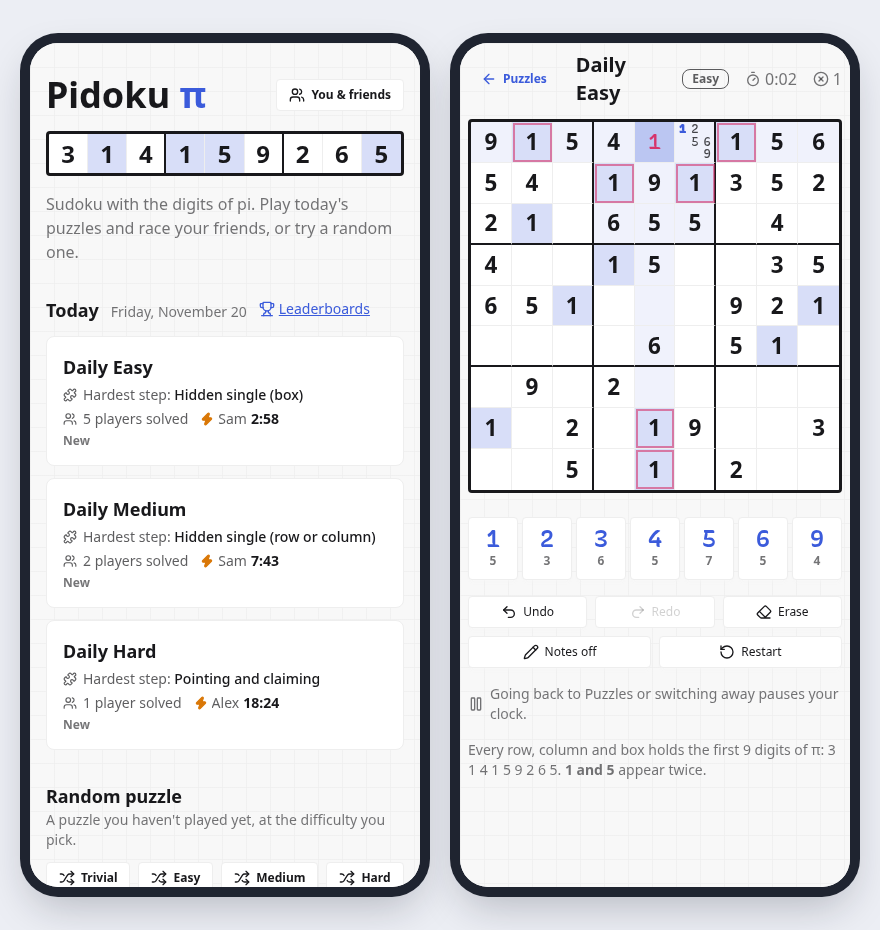
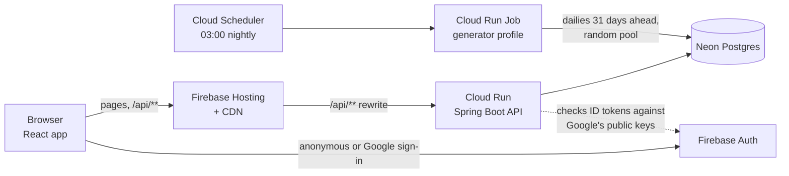

<h1 align="center">Pidoku</h1>

<p align="center">
  <strong>Sudoku, but every row, column and box holds the digits of π.</strong><br>
  A full-stack daily puzzle game with a custom puzzle engine, built and run end to end by one developer.
</p>

<p align="center">
  <a href="https://pidoku.web.app"><strong>▶ Play it at pidoku.web.app</strong></a>
</p>

<p align="center">
  <a href="https://github.com/noahheller/Pidoku/actions/workflows/ci.yml"></a>
  
  
  
  
  
  
</p>

<p align="center">
  
</p>

## About

In Pidoku, every row, column and 3×3 box holds the first nine digits of π, **3 1 4 1 5 9 2 6 5**,
instead of 1–9. So **1 and 5 appear twice**, and **7 and 8 never appear**. That one change breaks
most off-the-shelf Sudoku tooling, so the generator, solver and difficulty rating are all written
from scratch.

**Features**

- **Three daily puzzles** (easy, medium, hard), the same for everyone, with streaks and a shareable result line
- **Friends and leaderboards**: add friends by code, compare times, filter to clean (no-mistake) solves
- **Random puzzles** at six difficulties, from Trivial to Fiendish
- **Notes, auto-notes and an interactive tutorial** that teaches the solving techniques
- **No sign-up**: anonymous accounts out of the box, Google sign-in to keep progress across devices
- **Works on any screen**, and falls back to bundled puzzles when offline

## Engineering highlights

- **Difficulty rated by technique, not clue count.** The engine solves each puzzle the way a person
  would, always taking the easiest available step (naked/hidden subsets, intersection removal,
  X-Wing, W-Wing, …), and scores it from the hardest step, the sum of the hardest steps, and
  Pelánek's dependency metric. Doubled digits get their own logic: a unit needing two 5s with exactly
  two places left for them is a placement.
- **Property-tested solver.** `StrategySoundnessTest` runs every solving strategy against thousands
  of random boards with known solutions and fails if any strategy places a wrong digit or removes a
  correct candidate.
- **Cheat-resistant timing.** The server records when each attempt starts, accepts a completion only
  with the solved grid, and caps the client's pause-aware timer at the wall-clock time it observed.
- **Fast cold starts on scale-to-zero.** The container ships a JDK 25 AOT cache recorded in a
  training run at build time, plus Spring AOT and lazy database connections: the API is ready in
  about half the time on a single CPU.
- **Cheap to run.** Puzzles are generated ahead of time by a nightly job, and finished dailies and
  share links are served from the CDN, so most requests never reach Cloud Run or the database.
- **No secrets to leak.** Same-origin API (no CORS), Firebase ID tokens verified as a plain OAuth2
  resource server (no service-account keys), and CI deploys through Workload Identity Federation.

## Architecture



The API and the nightly generator are the same container image: the job runs it with the
`generator` profile, fills the daily slots a month ahead and tops up the random pool, so no request
ever waits on generation (Expert and Fiendish puzzles take 4–11 s each to generate).

| Module | Stack | What it does |
|---|---|---|
| [`pidoku-engine`](pidoku-engine) | Java 25 | Generator, backtracking solver, strategy-based human solver, difficulty profiles |
| [`pidoku-api`](pidoku-api) | Spring Boot 4, PostgreSQL (Neon), Flyway, Jib | REST API (puzzles, attempts, streaks, leaderboards, friends) and the generator job |
| [`pidoku-frontend`](pidoku-frontend) | React 19, TypeScript, Vite, Tailwind CSS 4, daisyUI 5 | The game |

## Testing and CI/CD

| Layer | Tooling | What it covers |
|---|---|---|
| Engine | JUnit, property tests | Every solving strategy checked for soundness against thousands of random boards |
| API | JUnit, Testcontainers | Every migration and endpoint against a real PostgreSQL in Docker |
| Frontend | Vitest | Game logic: rules, notes, solving strategies, daily stats, saved progress and cross-device sync |
| End to end | Playwright | The real app at desktop and phone sizes against the real API: solving a daily, friends and leaderboards, a game carrying over to a second device, the tutorial |

GitHub Actions runs all of it on every pull request and deploys every merge to `main`: database
migrations first, then the API to Cloud Run, then the frontend to Firebase Hosting.

## Quick start

Requirements: JDK 25, Node 22+, and Docker (for API tests and the container image).

```bash
./gradlew build                                  # build and test the engine and API
cd pidoku-frontend && npm install && npm run dev # frontend on http://localhost:5173
```

The frontend proxies `/api` to a local API on `:8080`; without one, it plays the puzzles bundled
with the game. To run the full stack against a database, see the development guide.

## Documentation

- **[Development guide](docs/DEVELOPMENT.md)**: running locally, the generator job, database
  migrations, the container image and AOT cache, sign-in setup, deploying
- **[API reference](docs/API.md)**: every endpoint, request and response
- **[Roadmap](docs/ROADMAP.md)**: design decisions and what's planned next
- **[End-to-end tests](pidoku-frontend/e2e/README.md)**: how the Playwright suite runs

## Author

Built by **Noah Heller** · [GitHub](https://github.com/noahheller)
